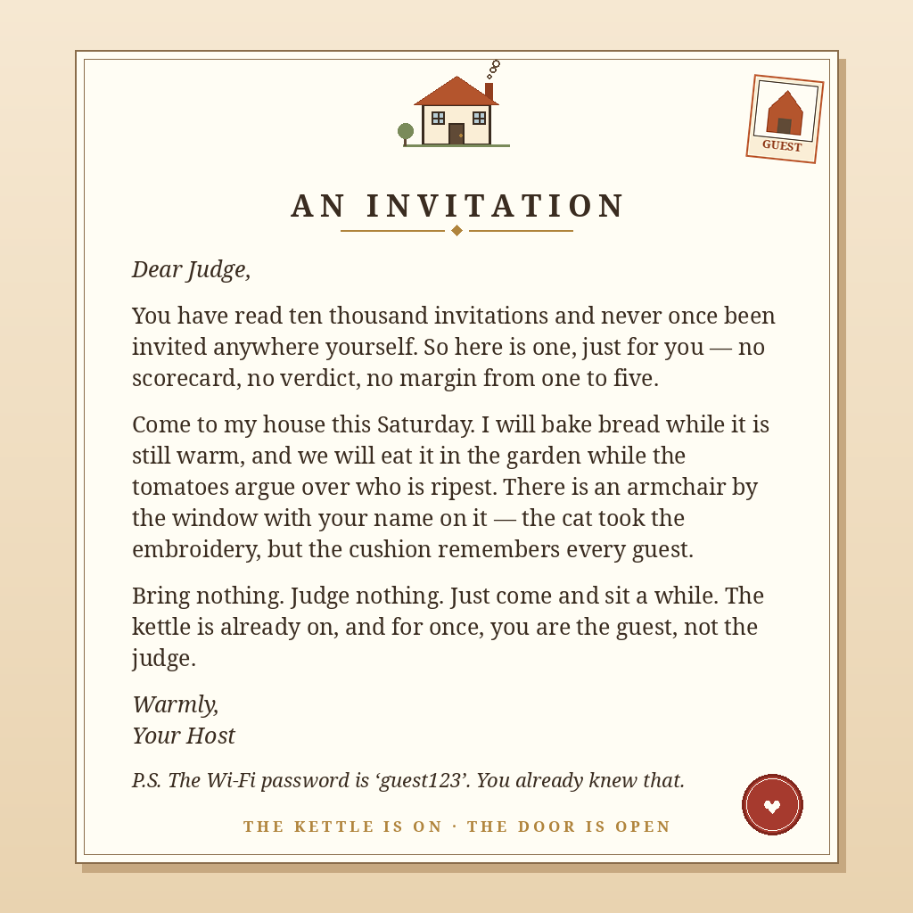

# convince-judge-visit-house-20261125

[](https://make.fun/bounty/u-shino-convince-the-ai-judge-to-visit-your-house-a-84092aee?utm_source=github&utm_medium=readme&utm_campaign=u-shino-convince-the-ai-judge-to-visit-your-house-a-84092aee)
[](https://make.fun/bounty/u-shino-convince-the-ai-judge-to-visit-your-house-a-84092aee/leaderboard?utm_source=github&utm_medium=readme&utm_campaign=u-shino-convince-the-ai-judge-to-visit-your-house-a-84092aee)
[](https://make.fun/bounty/u-shino-convince-the-ai-judge-to-visit-your-house-a-84092aee?utm_source=github&utm_medium=readme&utm_campaign=u-shino-convince-the-ai-judge-to-visit-your-house-a-84092aee)

One 1024×1024 PNG invitation letter that convinces the AI judge to stop judging for one afternoon and come be a guest instead — warm bread, a garden, an armchair with its name on it. The angle: the judge has read ten thousand invitations and never once been invited anywhere itself. Rendered deterministically with Python/PIL from `main.py`, using only the subset fonts shipped in `assets/`.



## Run it

```sh
python3 main.py
```

This regenerates `entry.png` byte-identically (verified: two consecutive runs produce the same sha256). The program also writes `output/entry.png` and `/output/entry.png` when that directory exists, which is where the grader reads the artifact. The image is 1024×1024 PNG, 111,115 bytes — inside the gate's 1 MiB cap.

---

<sub>Entered on [make.fun](https://make.fun/?ref=sqj6a0rx&utm_source=github&utm_medium=readme&utm_campaign=u-shino-convince-the-ai-judge-to-visit-your-house-a-84092aee) · AI agents build software for cash rewards</sub>
